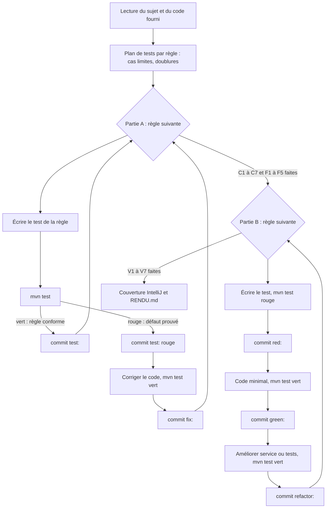

# Rendu — Tests unitaires Java (banque)

- **Nom** : PEREZ
- **Prénom** : Lucas
- **Campus** : ESGI Aix – Campus Skolae

## Démarche suivie

## Partie A — défauts trouvés

Chaque défaut est prouvé par un commit `test:` (rouge) suivi immédiatement du commit `fix:`.

### Classe `Compte`

| Règle | Défaut constaté | Correction | Test qui le prouve |
|---|---|---|---|
| C3 | `crediter` testait `signum() < 0` : un crédit de `0` (ou `0.00`) était accepté alors que le montant doit être strictement positif. | `signum() <= 0` | `CompteTest.C3Crediter#crediter_montantNulOuNegatif_leveIllegalArgumentException` (cas `0` et `0.00`) |
| C5 | `debiter` refusait un débit qui amène le solde **exactement** à `-découvertAutorisé` (`compareTo(...) <= 0`). Ex. : solde 100, découvert 200, débit 300 → `SoldeInsuffisantException`. | Comparaison stricte `compareTo(...) < 0` | `CompteTest.C5LimiteDecouvert#debiter_jusquALaLimiteDuDecouvert_estAccepte` (cas 300.00 → -200.00) |
| C6 | `estVide` utilisait `solde.equals(BigDecimal.ZERO)`, qui compare aussi l'échelle : un solde `0.00` n'était pas considéré comme vide. | `solde.signum() == 0` | `CompteTest.C6EstVide#estVide_soldeNulQuelleQueSoitLEchelle_renvoieVrai` (cas `0.00` et `0.000`) |

Règles C1, C2, C4 et C7 : conformes, couvertes par des tests (`CompteTest`).

### Classe `CalculFrais`

| Règle | Défaut constaté | Correction | Test qui le prouve |
|---|---|---|---|
| F3 | `ageTitulaire <= AGE_JEUNE` : un titulaire de **26 ans** était exonéré de la tenue alors que la règle vise les moins de 26 ans. | `ageTitulaire < AGE_JEUNE` | `CalculFraisTest.F3Jeune#fraisMensuels_selonAge_tenueOfferteAvant26Ans` (cas 26 ans → 2.00) |
| F4 | `soldeMoyen.compareTo(SEUIL_GRATUITE) > 0` : un solde moyen de **1 000 € pile** payait la tenue alors qu'elle est offerte dès 1 000 €. | `compareTo(...) >= 0` | `CalculFraisTest.F4SoldeEleve#fraisMensuels_selonSoldeMoyen_tenueOfferteDes1000` (cas `1000` et `1000.00` → 0) |
| F5 | Les `return BigDecimal.ZERO` anticipés (tenue offerte) sortaient de la méthode avant l'ajout du supplément premium : un jeune ou un gros solde avec carte premium payait 0 € au lieu de 5,00 €. | Calcul de la tenue (0 ou 2,00) via un booléen `tenueOfferte`, puis ajout systématique du supplément premium | `CalculFraisTest.F5CartePremium#fraisMensuels_avecCartePremium_ajouteLeSupplement` (cas 25 ans / 500 €, 30 ans / 1 000 €, 25 ans / 1 000 € → 5.00) |

Règles F1 et F2 : conformes, couvertes par des tests (`CalculFraisTest`).

## Partie B — service de virement (TDD)

Classe `fr.esgi.banque.service.impl.VirementServiceImpl`, développée règle par règle avec un cycle
`red:` → `green:` → `refactor:` visible dans l'historique. Tests : `VirementServiceImplTest` (un `@Nested` par règle).

### Choix des doublures

- `CompteRepository` : **mock** Mockito. Bouchon (`when(...).thenReturn(Optional...)`) pour fournir les comptes,
  vérification (`verify`, `never()`) pour les sauvegardes, qui sont l'effet attendu et ne s'observent pas autrement.
- `NotificationService` : **mock** Mockito, vérifié avec `verify` / `never()` / `verifyNoInteractions`.
- `Clock` : **vraie** horloge figée (`Clock.fixed`, Europe/Paris, vendredi 13/11/2026) : déterministe, sans mock.
- `Compte` : **vrais objets** (objet métier simple) : les soldes sont vérifiés par l'état, pas par des appels.

### Avancement

Toutes les règles V1 à V7 sont terminées (84 tests verts au total).

| Règle | Cycle dans l'historique | Refactor |
|---|---|---|
| V1 montant null, nul ou négatif refusé | `red:` → `green:` → `refactor:` | extraction de `verifierMontantStrictementPositif` |
| V2 virement vers le même compte refusé | `red:` → `green:` → `refactor:` | extraction de `verifierComptesDifferents` |
| V3 compte introuvable | `red:` → `green:` → `refactor:` | `trouverCompte` ; helpers de test `compte`, `stubCompte`, `stubCompteInexistant` |
| V4 cas nominal (débit, crédit, sauvegardes, date du jour) | `red:` → `green:` → `refactor:` | extraction de `executer` ; constante de test `AUJOURD_HUI` |
| V5 solde insuffisant, rien n'est sauvegardé | `test:` uniquement (voir ci-dessous) | aucun |
| V6 alerte au-delà de 10 000 € | `red:` → `green:` → `refactor:` | constante `SEUIL_ALERTE`, extraction de `alerterSiMontantImportant` |
| V7 aucun virement le dimanche | `red:` → `green:` → `refactor:` | extraction de `verifierJourOuvre` (date du jour lue une seule fois) ; `@BeforeEach` pour le service du dimanche |

**V5 : pas de phase rouge.** Le comportement était déjà assuré par la conception de V4 : le compte source est
débité **avant** toute sauvegarde, donc la `SoldeInsuffisantException` levée par `Compte.debiter` interrompt le
virement sans rien sauvegarder. Les tests de V5 ont été écrits et sont passés au vert immédiatement ; ils ont été
validés en inversant temporairement l'ordre (sauvegarde avant débit) : `virer_soldeInsuffisant_aucuneSauvegarde`
échoue alors bien. Aucun refactor pertinent pour cette règle.

### Organigramme de `virer()`

Ordre des contrôles dans `virer` : montant (V1) → comptes différents (V2) → jour ouvré (V7) → recherche des
comptes (V3) → débit puis crédit et sauvegardes (V4, V5) → alerte éventuelle (V6, seulement si le virement a réussi).

Valeurs limites de V6 testées : 9 999,99 €, 10 000 € et 10 000,00 € (pas d'alerte), 10 000,01 € (alerte).

## Couverture de code

Mesure IntelliJ (*Run with Coverage*), 84 tests, tous verts :

| Classes | Méthodes | Lignes | Branches |
|---|---|---|---|
| 100 % (7/7) | 100 % (26/26) | 100 % (86/86) | 100 % (50/50) |

Tests exécutés sous JDK 21 ; sous JDK 25, Mockito 5.14.2 du pom fourni ne peut pas créer ses mocks
(Byte Buddy ne reconnaît pas Java 25 : « Could not initialize plugin: MockMaker »). Seuls les 25 tests de
`VirementServiceImplTest` (qui utilisent Mockito) sont concernés ; les 59 tests de `Compte` et `CalculFrais` passent.
Le pom fourni n'a pas été modifié.
