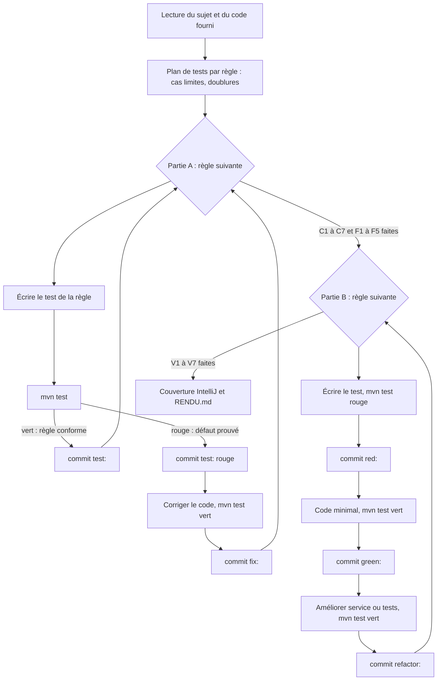
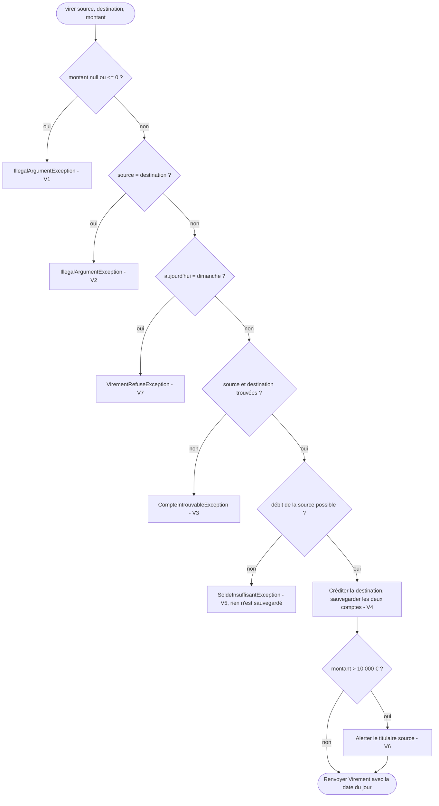
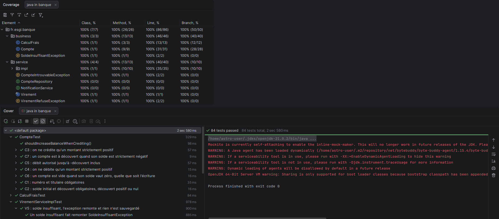

# Rendu — Tests unitaires et TDD (application bancaire)

| | |
|---|---|
| **Nom** | PEREZ |
| **Prénom** | Lucas |
| **Campus** | ESGI Aix – Campus Skolae |
| **Dépôt** | `Lucas_PEREZ_ESGI3_Java_TestsUnitaires_Projet` (branche `master`) |

## Sommaire

1. [Synthèse](#1-synthèse)
2. [Environnement](#2-environnement)
3. [Démarche suivie](#3-démarche-suivie)
4. [Partie A — tester et corriger l'existant](#4-partie-a--tester-et-corriger-lexistant)
5. [Partie B — service de virement en TDD](#5-partie-b--service-de-virement-en-tdd)
6. [Justifications](#6-justifications)
7. [Couverture de code](#7-couverture-de-code)

---

## 1. Synthèse

| Élément | Résultat |
|---|---|
| Partie A : règles testées | 12 / 12 (C1 à C7, F1 à F5) |
| Partie A : défauts trouvés et corrigés | **6** (C3, C5, C6, F3, F4, F5) |
| Partie B : règles développées en TDD | **7 / 7** (V1 à V7) |
| Règles non terminées | Aucune |
| Tests | **84**, tous verts (`mvn test`) |
| Couverture (IntelliJ) | **100 %** des classes, méthodes, lignes et branches |

## 2. Environnement

- Java 17 (cible du `pom.xml`), JUnit 6.1.3, AssertJ 3.26.3, Mockito 5.14.2.
- **Le `pom.xml` fourni n'a pas été modifié.**
- Tests exécutés sous **JDK 21**. Sous JDK 25, Mockito 5.14.2 ne peut pas créer ses mocks
  (Byte Buddy ne reconnaît pas Java 25 : *Could not initialize plugin: MockMaker*). Seuls les 25 tests de
  `VirementServiceImplTest` sont concernés ; les 59 tests de `Compte` et `CalculFrais` passent.

## 3. Démarche suivie

**Conventions de commit** (celles du sujet, plus `docs:`) : `test:` tests de l'existant · `fix:` correction, toujours
précédée du `test:` rouge qui prouve le défaut · `red:` / `green:` / `refactor:` cycle TDD de la partie B ·
`docs:` documentation.

**Pratiques appliquées** : structure Arrange / Act / Assert visible, un nom de test qui décrit un comportement
(`methode_contexte_resultatAttendu`) et un `@DisplayName` en français, une seule raison d'échouer par test,
tests paramétrés (`@CsvSource`, `@ValueSource`, `@NullSource`) pour les valeurs limites, comparaison des
`BigDecimal` avec `isEqualByComparingTo`.

---

## 4. Partie A — tester et corriger l'existant

Tests : `CompteTest` et `CalculFraisTest`, une classe `@Nested` par règle. Aucune doublure : `Compte` et
`CalculFrais` sont des objets métier simples, instanciés directement.

### 4.1 Bilan par règle

| Règle | Résultat | Valeurs limites testées | Commits |
|---|---|---|---|
| C1 numéro et titulaire obligatoires | Conforme | `null`, `""`, `" "` | `test:` |
| C2 solde et découvert obligatoires, découvert ≥ 0 | Conforme | découvert `-0.01` / `0` / `0.01` | `test:` |
| C3 crédit strictement positif | **Défaut** | `0`, `0.00`, `-0.01`, `0.01` | `test:` → `fix:` |
| C4 débit strictement positif | Conforme | `0`, `0.00`, `-0.01` | `test:` |
| C5 débit jusqu'à `-découvert` inclus | **Défaut** | débit `299.99` / `300.00` / `300.01` | `test:` → `fix:` |
| C6 compte vide quelle que soit l'écriture | **Défaut** | `0`, `0.00`, `0.000`, `±0.01` | `test:` → `fix:` |
| C7 découvert si solde strictement négatif | Conforme | `-0.01` / `0` / `0.01` | `test:` |
| F1 titulaire majeur, solde moyen obligatoire | Conforme | âge `17` / `18`, solde `null` | `test:` |
| F2 tenue de 2,00 € | Conforme | plusieurs profils sans exonération | `test:` |
| F3 tenue offerte avant 26 ans | **Défaut** | âge `25` / `26` | `test:` → `fix:` |
| F4 tenue offerte dès 1 000 € | **Défaut** | `999.99` / `1000` / `1000.01` | `test:` → `fix:` |
| F5 premium de 5,00 € toujours dû | **Défaut** | premium avec et sans tenue offerte | `test:` → `fix:` |

### 4.2 Défauts trouvés

Pour chaque défaut, le commit `test:` est rouge et le commit `fix:` qui le suit immédiatement le fait passer au vert.

#### C3 — `crediter` acceptait un montant nul
- **Règle** : `crediter` n'accepte qu'un montant strictement positif.
- **Défaut constaté** : le contrôle `montant.signum() < 0` laissait passer `0` et `0.00`.
- **Correction** : `montant.signum() <= 0`.
- **Test qui le prouve** : `CompteTest.C3Crediter#crediter_montantNulOuNegatif_leveIllegalArgumentException` (cas `0` et `0.00`).
- **Commits** : `55e0bfa` test → `8b9d83d` fix.

#### C5 — la limite exacte du découvert était refusée
- **Règle** : atteindre exactement `-découvertAutorisé` est autorisé.
- **Défaut constaté** : `compareTo(...) <= 0` refusait ce cas. Solde 100 €, découvert 200 € : débiter 300 € levait `SoldeInsuffisantException`.
- **Correction** : comparaison stricte `compareTo(...) < 0`.
- **Test qui le prouve** : `CompteTest.C5LimiteDecouvert#debiter_jusquALaLimiteDuDecouvert_estAccepte` (cas 300.00 → -200.00).
- **Commits** : `fc922e2` test → `084506d` fix.

#### C6 — `estVide` dépendait de l'écriture du zéro
- **Règle** : un compte est vide quand son solde vaut zéro, quelle que soit son écriture.
- **Défaut constaté** : `solde.equals(BigDecimal.ZERO)` compare aussi l'échelle : `0.00` n'était pas considéré comme vide.
- **Correction** : `solde.signum() == 0`.
- **Test qui le prouve** : `CompteTest.C6EstVide#estVide_soldeNulQuelleQueSoitLEchelle_renvoieVrai` (cas `0.00` et `0.000`).
- **Commits** : `684face` test → `15175e2` fix.

#### F3 — un titulaire de 26 ans était exonéré
- **Règle** : la tenue est offerte aux titulaires de **moins** de 26 ans.
- **Défaut constaté** : `ageTitulaire <= AGE_JEUNE` exonérait aussi les 26 ans.
- **Correction** : `ageTitulaire < AGE_JEUNE`.
- **Test qui le prouve** : `CalculFraisTest.F3Jeune#fraisMensuels_selonAge_tenueOfferteAvant26Ans` (cas 26 ans → 2,00 €).
- **Commits** : `9254297` test → `5798db6` fix.

#### F4 — un solde moyen de 1 000 € pile payait la tenue
- **Règle** : la tenue est offerte si le solde moyen atteint 1 000 € **ou plus**.
- **Défaut constaté** : `soldeMoyen.compareTo(SEUIL_GRATUITE) > 0` excluait 1 000 € pile.
- **Correction** : `compareTo(...) >= 0`.
- **Test qui le prouve** : `CalculFraisTest.F4SoldeEleve#fraisMensuels_selonSoldeMoyen_tenueOfferteDes1000` (cas `1000` et `1000.00` → 0).
- **Commits** : `b81b3ba` test → `5d96d8a` fix.

#### F5 — le supplément premium disparaissait quand la tenue était offerte
- **Règle** : la carte premium ajoute 5,00 €, toujours dus.
- **Défaut constaté** : les `return BigDecimal.ZERO` anticipés (tenue offerte) sortaient de la méthode avant l'ajout du supplément : 0 € au lieu de 5,00 €.
- **Correction** : calcul de la tenue (0 ou 2,00 €) via un booléen `tenueOfferte`, puis ajout systématique du supplément.
- **Test qui le prouve** : `CalculFraisTest.F5CartePremium#fraisMensuels_avecCartePremium_ajouteLeSupplement` (cas 25 ans / 500 €, 30 ans / 1 000 €, 25 ans / 1 000 € → 5,00 €).
- **Commits** : `f351919` test → `868c562` fix.

---

## 5. Partie B — service de virement en TDD

Classe `fr.esgi.banque.service.impl.VirementServiceImpl`, développée règle par règle sans code de production
écrit avant un test rouge. Créés au fil des cycles : le `record Virement`, `CompteIntrouvableException` et
`VirementRefuseException` (`RuntimeException`). Tests : `VirementServiceImplTest`, une classe `@Nested` par règle.

### 5.1 Choix des doublures

| Dépendance | Doublure | Usage | Pourquoi |
|---|---|---|---|
| `CompteRepository` | Mock Mockito | bouchon `when(trouver(...)).thenReturn(Optional...)` ; `verify` / `never()` sur `sauvegarder` | interface sans implémentation ; la sauvegarde est l'effet attendu et ne s'observe pas autrement |
| `NotificationService` | Mock Mockito | `verify` / `never()` / `verifyNoInteractions` sur `alerter` | l'alerte est un effet de bord sans état observable |
| `Clock` | Vraie horloge figée (`Clock.fixed`, Europe/Paris) | vendredi 13/11/2026, samedi 14/11, dimanche 15/11 | déterministe sans mock ; prévue pour être figée |
| `Compte` | Vrais objets | soldes vérifiés par l'état | objet métier simple : on ne le mocke pas |

### 5.2 Cycles TDD

| Règle | `red:` | `green:` | `refactor:` | Refactoring réalisé |
|---|---|---|---|---|
| V1 montant null, nul ou négatif refusé | `a9e8f92` (ne compile pas) | `244274f` | `aa0fd6a` | extraction de `verifierMontantStrictementPositif` |
| V2 virement vers le même compte refusé | `e571ca3` (1 échec) | `ab33bd5` | `25a5cf3` | extraction de `verifierComptesDifferents` |
| V3 compte introuvable | `78bb68b` (ne compile pas) | `78507ec` | `f2a4d4f` | `trouverCompte` ; helpers de test `compte`, `stubCompte`, `stubCompteInexistant` |
| V4 cas nominal | `734c948` (4 échecs) | `564dd1a` | `624721e` | extraction de `executer` ; constante de test `AUJOURD_HUI` |
| V5 solde insuffisant | — | — | — | test `e3edff9`, vert d'emblée (voir 6.1) |
| V6 alerte au-delà de 10 000 € | `39e2160` (1 échec) | `10a8825` | `ba208c5` | constante `SEUIL_ALERTE`, extraction de `alerterSiMontantImportant` |
| V7 aucun virement le dimanche | `0973dec` (ne compile pas) | `4e9589b` | `d47e2d7` | extraction de `verifierJourOuvre` (date lue une seule fois) ; `@BeforeEach` du service du dimanche |

Un `red:` qui ne compile pas est un échec au sens du TDD (2e loi) et est autorisé par le sujet.

### 5.3 Algorithme de `virer()`

---

## 6. Justifications

### 6.1 V5 n'a pas de phase rouge
Le comportement était déjà garanti par la conception de V4 : le compte source est **débité avant toute
sauvegarde**, donc la `SoldeInsuffisantException` levée par `Compte.debiter` interrompt le virement sans rien
sauvegarder. Les tests de V5 sont passés au vert dès leur écriture ; comme un test qui passe du premier coup ne
prouve rien, ils ont été validés en inversant temporairement l'ordre (sauvegarde avant débit) :
`virer_soldeInsuffisant_aucuneSauvegarde` échoue alors bien. Le commit est donc un `test:` et non un
`red:`/`green:`, et aucun refactoring n'était pertinent.

### 6.2 Plusieurs tests dans un même `red:` (V4, V7)
Chaque `red:` couvre **une seule règle**. V4 vérifie les quatre facettes du cas nominal (débit, crédit,
sauvegardes, date du jour) dans quatre tests distincts pour garder **une seule raison d'échouer par test** ;
V7 vérifie de même l'exception, l'absence de sauvegarde et l'absence d'alerte. Le test du samedi (V7) est une
valeur limite qui garantit qu'on ne bloque que le dimanche.

### 6.3 Ordre des contrôles dans `virer()`
1. **V1 puis V2** : ils ne dépendent que des paramètres ; un refus à ce stade n'interroge aucune dépendance
   (vérifié par `verifyNoInteractions` pour V1).
2. **V7 avant V3** : un virement le dimanche est refusé sans même chercher les comptes.
3. **Débit avant crédit et sauvegardes** : en cas de solde insuffisant (V5), rien n'est sauvegardé.
4. **V6 en dernier** : l'alerte n'est envoyée que pour un virement réussi et sauvegardé.

### 6.4 Vérification d'état ou d'interaction
La vérification d'état est privilégiée (soldes, `Virement` renvoyé, exceptions). `verify` n'est utilisé que
lorsque l'appel **est** l'effet attendu : sauvegarde des comptes (V3, V4, V5, V7) et alerte (V6, V7). Le
message d'alerte est vérifié avec `anyString()` : le sujet ne l'impose pas, et le figer rendrait le test fragile ;
le titulaire, lui, est vérifié avec `eq(...)`.

### 6.5 Valeurs limites de V6
`9 999,99 €`, `10 000 €` et `10 000,00 €` : pas d'alerte (`never()`) · `10 000,01 €` : alerte au titulaire du
compte source.

---

## 7. Couverture de code

Mesure IntelliJ (*Run with Coverage*), 84 tests verts sous JDK 21 :

| Classes | Méthodes | Lignes | Branches |
|---|---|---|---|
| 100 % (7/7) | 100 % (26/26) | 100 % (86/86) | 100 % (50/50) |

`CompteRepository` et `NotificationService` apparaissent à 0/0 : ce sont des interfaces, sans code exécutable.
